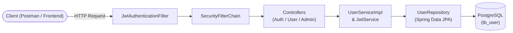
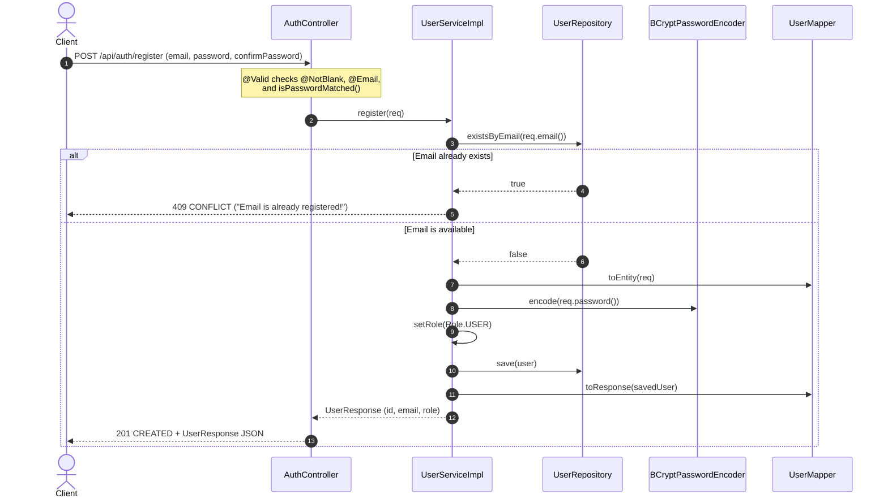
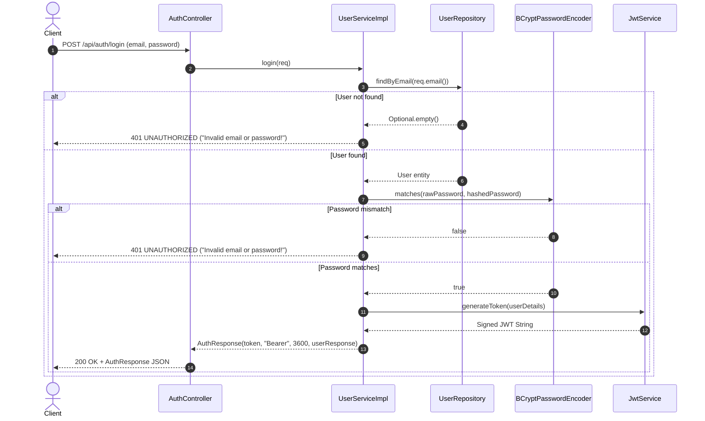
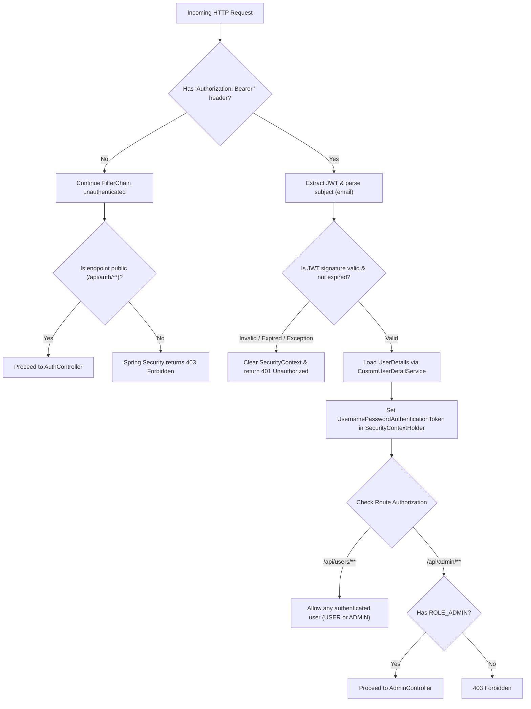

# 🔐 AuthDemo — Spring Boot JWT Authentication & Authorization

A complete, production-style **Stateless JWT Authentication and Role-Based Access Control (RBAC)** REST API built from the ground up with **Java 21** and **Spring Boot 3**.

This project demonstrates how to secure a modern Spring Boot backend from start to finish—covering user registration, BCrypt password hashing, JWT generation & verification, custom Spring Security filter chains, DTO validation, MapStruct object mapping, centralized exception handling, and unit testing with Mockito.

---

## ✨ Key Features

- **Stateless JWT Security**: Zero server-side session storage (`SessionCreationPolicy.STATELESS`). Every protected request is authenticated via a signed `Bearer` token.
- **Role-Based Access Control (RBAC)**: Supports `USER` and `ADMIN` roles (`ROLE_USER`, `ROLE_ADMIN`) with route-level authorization rules.
- **Strong Password Hashing**: Uses `BCryptPasswordEncoder` (strength `12`) so raw passwords are never stored in the database.
- **Clean Layered Architecture**: Strict separation between Controllers, Services, Repositories, Entities, DTOs (Java `record`s), Mappers, and Security components.
- **Request Validation & Custom Error Format**: Declarative validation using Jakarta Validation (`@NotBlank`, `@Email`, `@AssertTrue`) handled globally via `@RestControllerAdvice`.
- **Environment-Driven Configuration**: Sensitive credentials (database URL, credentials, JWT secret key) are loaded from a `.env` file via `dotenv-java`.
- **Automated Unit Testing**: Includes isolated unit tests (`UserServiceImplTest`) using JUnit 5 and Mockito.

---

## 🛠️ Tech Stack

| Category | Technology | Version |
| :--- | :--- | :--- |
| **Language** | Java | 21 |
| **Framework** | Spring Boot (`web`, `data-jpa`, `security`, `validation`) | 3.3.4 |
| **JWT Library** | JJWT (`jjwt-api`, `jjwt-impl`, `jjwt-jackson`) | 0.12.6 |
| **Database** | PostgreSQL | Runtime |
| **Object Mapping** | MapStruct + Lombok (`lombok-mapstruct-binding`) | 1.6.3 |
| **Environment Config** | `dotenv-java` | 3.0.2 |
| **API Documentation** | SpringDoc OpenAPI (Swagger UI) | 2.6.0 |
| **Testing** | JUnit 5, Mockito, Spring Security Test | Boot Managed |

---

## 📂 Project Folder Structure

```text
AuthDemo/
├── pom.xml                                      # Maven dependencies & annotation processors (Lombok + MapStruct)
├── mvnw / mvnw.cmd                              # Maven wrapper scripts
├── .env                                         # Local environment variables (ignored in Git)
└── src/
    ├── main/
    │   ├── java/com/example/AuthDemo/
    │   │   ├── AuthDemoApplication.java         # Application entry point; loads .env into System properties
    │   │   │
    │   │   ├── config/
    │   │   │   └── SecurityConfig.java          # Configures BCrypt, DaoAuthenticationProvider & SecurityFilterChain
    │   │   │
    │   │   ├── security/
    │   │   │   ├── JwtService.java              # Generates, signs, parses, and validates JWT tokens (HMAC-SHA)
    │   │   │   ├── JwtAuthenticationFilter.java # Intercepts every HTTP request to validate Bearer tokens
    │   │   │   └── CustomUserDetailService.java # Loads User from DB and adapts it to Spring Security UserDetails
    │   │   │
    │   │   ├── controller/
    │   │   │   ├── AuthController.java          # Public endpoints: POST /api/auth/register & POST /api/auth/login
    │   │   │   ├── UserController.java          # Authenticated endpoint: GET /api/users/me
    │   │   │   └── AdminController.java         # Admin-only endpoints: GET /api/admin/me & GET /api/admin/dashboard
    │   │   │
    │   │   ├── service/
    │   │   │   ├── UserService.java             # Business logic interface for registration and login
    │   │   │   └── impl/
    │   │   │       └── UserServiceImpl.java     # Implements registration, password verification & token creation
    │   │   │
    │   │   ├── repository/
    │   │   │   └── UserRepository.java          # Spring Data JPA repository (findByEmail, existsByEmail)
    │   │   │
    │   │   ├── entity/
    │   │   │   └── User.java                    # JPA Entity mapped to table "tb_user"
    │   │   │
    │   │   ├── enums/
    │   │   │   └── Role.java                    # Enum defining USER and ADMIN roles
    │   │   │
    │   │   ├── dtos/
    │   │   │   ├── Request/
    │   │   │   │   ├── UserRegisterRequest.java # Registration payload + password match validation
    │   │   │   │   └── UserLoginRequest.java    # Login payload (email & password)
    │   │   │   └── Response/
    │   │   │       ├── AuthResponse.java        # Login response (JWT token, tokenType, expiresIn, user info)
    │   │   │       ├── UserResponse.java        # Safe user profile projection (id, email, role)
    │   │   │       └── ErrorResponse.java       # Standardized error response (timestamp, status, error, message)
    │   │   │
    │   │   ├── mapper/
    │   │   │   └── UserMapper.java              # MapStruct mapper converting between UserRegisterRequest, User, and UserResponse
    │   │   │
    │   │   └── exceptions/
    │   │       └── GlobalExceptionHandler.java  # @RestControllerAdvice handling validation & HTTP status exceptions
    │   │
    │   └── resources/
    │       └── application.properties           # App port, PostgreSQL JPA config, and JWT property placeholders
    │
    └── test/
        └── java/com/example/AuthDemo/
            ├── AuthDemoApplicationTests.java    # Spring context smoke test
            └── service/
                └── UserServiceImplTest.java     # Unit tests for register & login scenarios using Mockito
```

---

## 🔄 Application Architecture & Authentication Flows

### 1. High-Level Architecture Overview



---

### 2. Flow A: User Registration (`POST /api/auth/register`)

When a new user signs up, their input is validated, their password is encrypted with BCrypt, and a default role of `USER` is assigned before saving to PostgreSQL.



---

### 3. Flow B: User Login & JWT Issuance (`POST /api/auth/login`)

When an existing user logs in, the service verifies their email and BCrypt password hash, then generates a signed JWT containing their email as the `subject` (`sub`), issued-at timestamp (`iat`), and expiration timestamp (`exp`).



---

### 4. Flow C: Accessing Protected Endpoints (`JwtAuthenticationFilter`)

Every incoming request passes through `JwtAuthenticationFilter` (which extends `OncePerRequestFilter`) **before** `UsernamePasswordAuthenticationFilter`:



---

## 🌐 API Endpoints Reference

### 1. Public Authentication Endpoints (`/api/auth`)

#### **Register a New User**
- **Endpoint**: `POST /api/auth/register`
- **Access**: Public (`permitAll`)
- **Request Body**:
  ```json
  {
    "email": "student@example.com",
    "password": "MyPassword123",
    "confirmPassword": "MyPassword123"
  }
  ```
- **Success Response (`201 Created`)**:
  ```json
  {
    "id": 1,
    "email": "student@example.com",
    "role": "USER"
  }
  ```

#### **Login**
- **Endpoint**: `POST /api/auth/login`
- **Access**: Public (`permitAll`)
- **Request Body**:
  ```json
  {
    "email": "student@example.com",
    "password": "MyPassword123"
  }
  ```
- **Success Response (`200 OK`)**:
  ```json
  {
    "token": "eyJhbGciOiJIUzI1NiJ9...",
    "tokenType": "Bearer",
    "expiresIn": 3600,
    "user": {
      "id": 1,
      "email": "student@example.com",
      "role": "USER"
    }
  }
  ```

---

### 2. Protected Endpoints

> **Important**: Include the JWT token in the `Authorization` header for all protected endpoints:
> ```http
> Authorization: Bearer <your_jwt_token>
> ```

| Method | Endpoint | Required Role | Response (`200 OK`) |
| :--- | :--- | :--- | :--- |
| `GET` | `/api/users/me` | Any Authenticated User (`USER` or `ADMIN`) | `"You are authenticated"` |
| `GET` | `/api/admin/me` | `ADMIN` only (`hasRole("ADMIN")`) | `"Admin is authenticated"` |
| `GET` | `/api/admin/dashboard` | `ADMIN` only (`hasRole("ADMIN")`) | `"Get admin dashboard"` |

---

### 3. Standardized Error Responses (`GlobalExceptionHandler`)

Validation failures (`400 Bad Request`), duplicate emails (`409 Conflict`), and invalid credentials (`401 Unauthorized`) return a clean `ErrorResponse` JSON structure:

```json
{
  "timestamp": "2026-10-22T13:30:00.123456",
  "status": 400,
  "error": "Bad Request",
  "message": "Password and confirm password do not match!"
}
```

---

## ⚙️ Environment & Configuration Setup

### 1. Prerequisites
- **JDK 21** installed
- **PostgreSQL** running locally or remotely
- **Maven** (or use the included `./mvnw` wrapper)

### 2. Configure `.env` File
Create a `.env` file in the root directory of the project:

```env
DB_URL=jdbc:postgresql://localhost:5432/your_database_name
DB_USERNAME=your_db_username
DB_PASSWORD=your_db_password
JWT_SECRETKEY=your_base64_encoded_256_bit_secret_key
```

> 💡 **Tip — Generating a valid Base64 `JWT_SECRETKEY`**:
> JJWT requires a Base64-encoded key of at least 256 bits (32 bytes) for HMAC-SHA256. You can generate one in your terminal with:
> ```bash
> openssl rand -base64 32
> ```

---

## 🚀 Running the Project & Tests

### Run the Application
```bash
./mvnw spring-boot:run
```
The server will start on **`http://localhost:8080`**.

### Explore with Swagger UI
Once the application is running, open your browser and visit:
- **Swagger UI**: `http://localhost:8080/swagger-ui/index.html`
- **OpenAPI JSON**: `http://localhost:8080/v3/api-docs`

### Run Unit Tests
The project includes unit tests in `UserServiceImplTest` covering:
1. `register_shouldSaveUserWithHasedPassword`
2. `register_shouldRejectDuplicatedEmail`
3. `login_shouldReturnAuthResponse_whenCredentialsAreValid`
4. `login_shouldThrowUnauthorized_whenPasswordIsIncorrect`

Run all tests with:
```bash
./mvnw test
```

